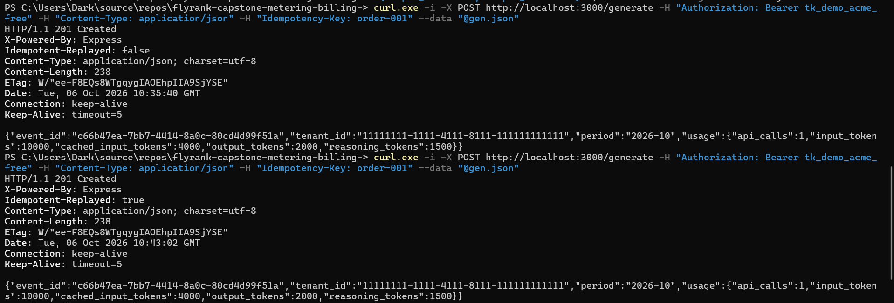
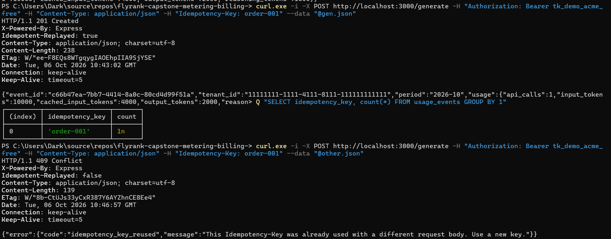
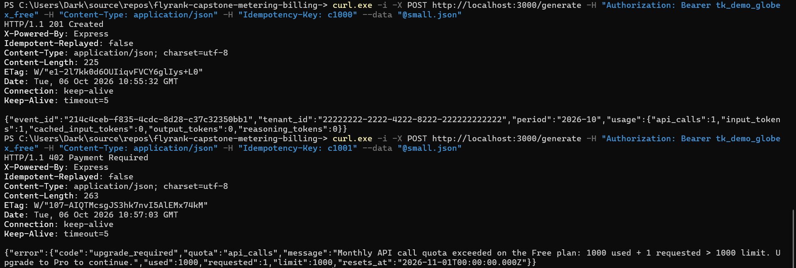
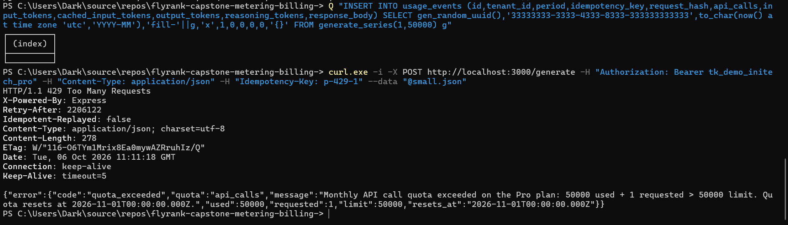
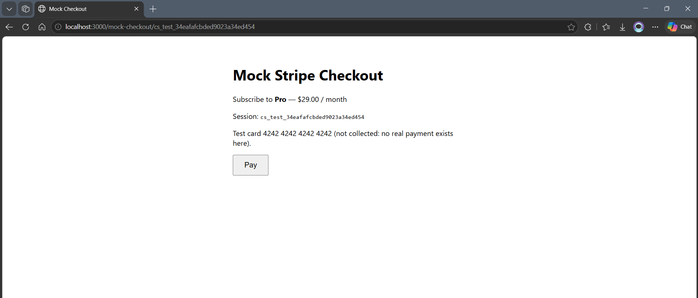
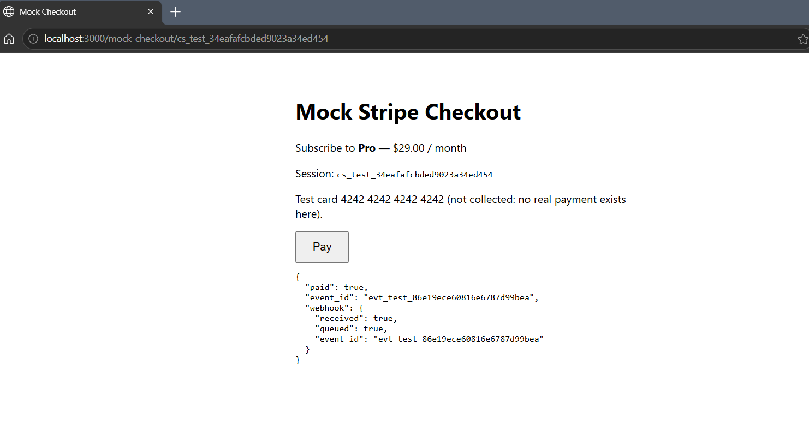

```bash
PS C:\Users\Dark\source\repos\flyrank-capstone-metering-billing-> $acme = @{ Authorization = "Bearer tk_demo_acme_free" }
PS C:\Users\Dark\source\repos\flyrank-capstone-metering-billing-> $pro  = @{ Authorization = "Bearer tk_demo_initech_pro" }
PS C:\Users\Dark\source\repos\flyrank-capstone-metering-billing-> function Q($sql) { node --env-file=.env -e "const {pool}=require('./src/db');pool.query(process.argv[1]).then(r=>{console.table(r.rows);pool.end()})" $sql }
PS C:\Users\Dark\source\repos\flyrank-capstone-metering-billing-> '{"input_tokens":10000,"cached_input_tokens":4000,"output_tokens":2000,"reasoning_tokens":1500}' | Out-File -Encoding ascii gen.json
PS C:\Users\Dark\source\repos\flyrank-capstone-metering-billing-> '{"input_tokens":1,"output_tokens":0}' | Out-File -Encoding ascii small.json
PS C:\Users\Dark\source\repos\flyrank-capstone-metering-billing-> '{"input_tokens":5,"output_tokens":5}' | Out-File -Encoding ascii other.json
```

## Metering 

### BOX 1
```bash
PS C:\Users\Dark\source\repos\flyrank-capstone-metering-billing-> curl.exe -i -X POST http://localhost:3000/generate -H "Authorization: Bearer tk_demo_acme_free" -H "Content-Type: application/json" -H "Idempotency-Key: order-001" --data "@gen.json"
HTTP/1.1 201 Created
X-Powered-By: Express
Idempotent-Replayed: false
Content-Type: application/json; charset=utf-8
Content-Length: 238
ETag: W/"ee-F8EQs8WTgqygIAOEhpIIA9SjYSE"
Date: Tue, 06 Oct 2026 10:35:40 GMT
Connection: keep-alive
Keep-Alive: timeout=5

,"usage":{"api_calls":1,"input_tokens":10000,"cached_input_tokens":4000,"output_tokens":2000,"reasoning_tokens":1500}}
```


### BOX 2
```bash
PS C:\Users\Dark\source\repos\flyrank-capstone-metering-billing-> Q "SELECT idempotency_key, count(*) FROM usage_events GROUP BY 1"
┌─────────┬─────────────────┬───────┐
│ (index) │ idempotency_key │ count │
├─────────┼─────────────────┼───────┤
│ 0       │ 'order-001'     │ 1n    │
└─────────┴─────────────────┴───────┘
PS C:\Users\Dark\source\repos\flyrank-capstone-metering-billing-> curl.exe -i -X POST http://localhost:3000/generate -H "Authorization: Bearer tk_demo_acme_free" -H "Content-Type: application/json" -H "Idempotency-Key: order-001" --data "@other.json"
HTTP/1.1 409 Conflict
X-Powered-By: Express
Idempotent-Replayed: false
Content-Type: application/json; charset=utf-8
Content-Length: 139
ETag: W/"8b-CtUJs33yCxR387Y6AYZhnCE8Ee4"
Date: Tue, 06 Oct 2026 10:46:57 GMT
Connection: keep-alive
Keep-Alive: timeout=5

{"error":{"code":"idempotency_key_reused","message":"This Idempotency-Key was already used with a different request body. Use a new key."}}

PS C:\Users\Dark\source\repos\flyrank-capstone-metering-billing-> npm test

> flyrank-capstone-metering-billing-@1.0.0 test
> node --env-file=.env --test --test-concurrency=1

✔ same key twice: one event and same identical response (486.5175ms)
✔ 20 retries at the same moment: still one event (413.9895ms)
✔ same key, different body: 409, nothing stored (13.7075ms)
✔ invalid input: 400, nothing stored (16.7146ms)
✔ quota boundary: call 1000 passes, call 1001 gets 402 (134.4769ms)
✔ a retry still works after the quota is full (12.1484ms)
✔ token quota: a request that would exceed it is rejected whole (33.1582ms)
✔ GET /usage reports the same numbers, and only for this tenant (11.0889ms)
✔ worked example: every category at once (1.3252ms)
✔ cached tokens are billed once, at the cheaper rate (0.1942ms)
✔ the naive "add every category" calculation would be wrong (0.2094ms)
✔ reasoning tokens cost the same as output tokens (0.2597ms)
✔ totals are exact: 1000 small calls equal one big one (0.1859ms)
✔ rounding to cents happens once, half up (0.9325ms)
✔ zero usage costs zero (0.2563ms)
ℹ tests 15
ℹ suites 0
ℹ pass 15
ℹ fail 0
ℹ cancelled 0
ℹ skipped 0
ℹ todo 0
ℹ duration_ms 2442.5227
```


### QUOTAS

```bash
PS C:\Users\Dark\source\repos\flyrank-capstone-metering-billing-> Q "INSERT INTO usage_events (id,tenant_id,period,idempotency_key,request_hash,api_calls,input_tokens,cached_input_tokens,output_tokens,reasoning_tokens,response_body) SELECT gen_random_uuid(),'22222222-2222-4222-8222-222222222222',to_char(now() at time zone 'utc','YYYY-MM'),'fill-'||g,'x',1,0,0,0,0,'{}' FROM generate_series(1,999) g"
┌─────────┐
│ (index) │
├─────────┤
└─────────┘
```
#### On the border 999 api used , Allowed 
```bash
PS C:\Users\Dark\source\repos\flyrank-capstone-metering-billing-> curl.exe -i -X POST http://localhost:3000/generate -H "Authorization: Bearer tk_demo_globex_free" -H "Content-Type: application/json" -H "Idempotency-Key: c1000" --data "@small.json"
HTTP/1.1 201 Created
X-Powered-By: Express
Idempotent-Replayed: false
Content-Type: application/json; charset=utf-8
Content-Length: 225
ETag: W/"e1-2l7kk0d6OUIiqvFVCY6glIys+L0"
Date: Tue, 06 Oct 2026 10:55:32 GMT
Connection: keep-alive
Keep-Alive: timeout=5

{"event_id":"214c4ceb-f835-4cdc-8d28-c37c32350bb1","tenant_id":"22222222-2222-4222-8222-222222222222","period":"2026-10","usage":{"api_calls":1,"input_tokens":1,"cached_input_tokens":0,"output_tokens":0,"reasoning_tokens":0}}
```
#### Limit Reached and Going above , Denied 
```bash
PS C:\Users\Dark\source\repos\flyrank-capstone-metering-billing-> curl.exe -i -X POST http://localhost:3000/generate -H "Authorization: Bearer tk_demo_globex_free" -H "Content-Type: application/json" -H "Idempotency-Key: c1001" --data "@small.json"
HTTP/1.1 402 Payment Required
X-Powered-By: Express
Idempotent-Replayed: false
Content-Type: application/json; charset=utf-8
Content-Length: 263
ETag: W/"107-AIQTMcsgJS3hk7nvI5AlEMx74kM"
Date: Tue, 06 Oct 2026 10:57:03 GMT
Connection: keep-alive
Keep-Alive: timeout=5

{"error":{"code":"upgrade_required","quota":"api_calls","message":"Monthly API call quota exceeded on the Free plan: 1000 used + 1 requested > 1000 limit. Upgrade to Pro to continue.","used":1000,"requested":1,"limit":1000,"resets_at":"2026-11-01T00:00:00.000Z"}}
```


```bash
PS C:\Users\Dark\source\repos\flyrank-capstone-metering-billing-> Q "INSERT INTO usage_events (id,tenant_id,period,idempotency_key,request_hash,api_calls,input_tokens,cached_input_tokens,output_tokens,reasoning_tokens,response_body) SELECT gen_random_uuid(),'33333333-3333-4333-8333-333333333333',to_char(now() at time zone 'utc','YYYY-MM'),'fill-'||g,'x',1,0,0,0,0,'{}' FROM generate_series(1,50000) g"
┌─────────┐
│ (index) │
├─────────┤
└─────────┘
PS C:\Users\Dark\source\repos\flyrank-capstone-metering-billing-> curl.exe -i -X POST http://localhost:3000/generate -H "Authorization: Bearer tk_demo_initech_pro" -H "Content-Type: application/json" -H "Idempotency-Key: p-429-1" --data "@small.json"
HTTP/1.1 429 Too Many Requests
X-Powered-By: Express
Retry-After: 2206122
Idempotent-Replayed: false
Content-Type: application/json; charset=utf-8
Content-Length: 278
ETag: W/"116-O6TYm1Mrix8Ea0mywAZRruhIz/Q"
Date: Tue, 06 Oct 2026 11:11:18 GMT
Connection: keep-alive
Keep-Alive: timeout=5

{"error":{"code":"quota_exceeded","quota":"api_calls","message":"Monthly API call quota exceeded on the Pro plan: 50000 used + 1 requested > 50000 limit. Quota resets at 2026-11-01T00:00:00.000Z.","used":50000,"requested":1,"limit":50000,"resets_at":"2026-11-01T00:00:00.000Z"}}
PS C:\Users\Dark\source\repos\flyrank-capstone-metering-billing->
```


### Cost Calculation

#### Box 5 And Box 6
```bash
PS C:\Users\Dark\source\repos\flyrank-capstone-metering-billing-> Invoke-RestMethod -Uri http://localhost:3000/usage -Headers $acme | ConvertTo-Json -Depth 5
{
    "tenant_id":  "11111111-1111-4111-8111-111111111111",
    "plan":  "free",
    "status":  "active",
    "period":  "2026-10",
    "resets_at":  "2026-11-01T00:00:00.000Z",
    "api_calls":  {
                      "used":  1,
                      "limit":  1000,
                      "remaining":  999
                  },
    "ai_tokens":  {
                      "used":  13500,
                      "limit":  100000,
                      "remaining":  86500,
                      "breakdown":  {
                                        "input":  10000,
                                        "cached_input":  4000,
                                        "output":  2000,
                                        "reasoning":  1500
                                    }
                  },
    "cost":  {
                 "breakdown_nanos":  {
                                         "api_calls":  "1000000",
                                         "uncached_input":  "1800000",
                                         "cached_input":  "120000",
                                         "output":  "5000000",
                                         "reasoning":  "3750000"
                                     },
                 "usage_total_nanos":  "11670000",
                 "usage_total_usd":  "0.011670000",
                 "usage_total_cents":  1,
                 "plan_fee_cents":  0,
                 "invoice_total_cents":  1
             },
    "pricing_nanos_per_token":  {
                                    "uncached_input":  300,
                                    "cached_input":  30,
                                    "output":  2500,
                                    "reasoning":  2500,
                                    "per_api_call":  1000000
                                }
}
```
#### BOX 7
```js
const NANOS_PER_USD = 1_000_000_000n;

const PRICING = Object.freeze({
  UNCACHED_INPUT_TOKEN: 300n,   
  CACHED_INPUT_TOKEN: 30n,      
  OUTPUT_TOKEN: 2_500n,         
  REASONING_TOKEN: 2_500n,    
    API_CALL: 1_000_000n,         
});
```
```bash

PS C:\Users\Dark\source\repos\flyrank-capstone-metering-billing-> npm test

> flyrank-capstone-metering-billing-@1.0.0 test
> node --env-file=.env --test --test-concurrency=1

✔ same key twice: one event and same identical response (482.9176ms)
✔ 20 retries at the same moment: still one event (387.2298ms)
✔ same key, different body: 409, nothing stored (13.1017ms)
✔ invalid input: 400, nothing stored (13.6861ms)
✔ quota boundary: call 1000 passes, call 1001 gets 402 (307.1699ms)
✔ a retry still works after the quota is full (12.1535ms)
✔ token quota: a request that would exceed it is rejected whole (30.6776ms)
✔ GET /usage reports the same numbers, and only for this tenant (8.445ms)
✔ worked example: every category at once (1.3665ms)
✔ cached tokens are billed once, at the cheaper rate (0.1889ms)
✔ the naive "add every category" calculation would be wrong (0.2218ms)
✔ reasoning tokens cost the same as output tokens (0.2585ms)
✔ totals are exact: 1000 small calls equal one big one (0.1828ms)
✔ rounding to cents happens once, half up (0.9879ms)
✔ zero usage costs zero (0.2528ms)
ℹ tests 15
ℹ suites 0
ℹ pass 15
ℹ fail 0
ℹ cancelled 0
ℹ skipped 0
ℹ todo 0
ℹ duration_ms 2600.9947
```

### Stripe Integration

#### Box 8
```bash
PS C:\Users\Dark\source\repos\flyrank-capstone-metering-billing-> $s = Invoke-RestMethod -Method Post -Uri http://localhost:3000/billing/checkout -Headers $acme
PS C:\Users\Dark\source\repos\flyrank-capstone-metering-billing-> $s | ConvertTo-Json
{
    "checkout_url":  "http://localhost:3000/mock-checkout/cs_test_34eafafcbded9023a34ed454",
    "session_id":  "cs_test_34eafafcbded9023a34ed454",
    "plan":  "pro",
    "price_cents":  2900
}
```



```bash
PS C:\Users\Dark\source\repos\flyrank-capstone-metering-billing-> Invoke-RestMethod -Uri http://localhost:3000/usage -Headers $acme


tenant_id               : 11111111-1111-4111-8111-111111111111
plan                    : pro
status                  : active
period                  : 2026-10
resets_at               : 2026-11-01T00:00:00.000Z
api_calls               : @{used=1; limit=50000; remaining=49999}
ai_tokens               : @{used=13500; limit=5000000; remaining=4986500; breakdown=}
cost                    : @{breakdown_nanos=; usage_total_nanos=11670000; usage_total_usd=0.011670000; usage_total_cents=1; plan_fee_cents=2900;
                          invoice_total_cents=2901}
pricing_nanos_per_token : @{uncached_input=300; cached_input=30; output=2500; reasoning=2500; per_api_call=1000000}
```

### Box 9
```bash
PS C:\Users\Dark\source\repos\flyrank-capstone-metering-billing-> node --env-file=.env scripts/send-subscription-event.js past_due --replay
subscription sub_test_9023a34ed454 (plan pro) -> status "past_due"
signed -> HTTP 200 {"received":true,"queued":true,"event_id":"evt_test_past_due_1791286375609"}
replay -> HTTP 200 {"received":true,"duplicate":true,"event_id":"evt_test_past_due_1791286375609"}
PS C:\Users\Dark\source\repos\flyrank-capstone-metering-billing-> node --env-file=.env scripts/send-subscription-event.js past_due --forge
subscription sub_test_9023a34ed454 (plan pro) -> status "past_due"
FORGED -> HTTP 400 {"error":{"code":"invalid_signature","message":"Signature verification failed."}}

PS C:\Users\Dark\source\repos\flyrank-capstone-metering-billing-> Q "SELECT name, plan_id, status FROM tenants WHERE name='Acme'"
┌─────────┬────────┬─────────┬────────────┐
│ (index) │ name   │ plan_id │ status     │
├─────────┼────────┼─────────┼────────────┤
│ 0       │ 'Acme' │ 'pro'   │ 'past_due' │
└─────────┴────────┴─────────┴────────────┘

PS C:\Users\Dark\source\repos\flyrank-capstone-metering-billing-> curl.exe -i -X POST http://localhost:3000/generate -H "Authorization: Bearer tk_demo_acme_free" -H "Content-Type: application/json" -H "Idempotency-Key: pd1" --data "@small.json"
HTTP/1.1 402 Payment Required
X-Powered-By: Express
Idempotent-Replayed: false
Content-Type: application/json; charset=utf-8
Content-Length: 135
ETag: W/"87-T4kuQMaEeDwmCtFeFBdGiJLDzdQ"
Date: Tue, 06 Oct 2026 11:35:09 GMT
Connection: keep-alive
Keep-Alive: timeout=5

{"error":{"code":"payment_required","message":"The last payment for this subscription failed. Update the payment method to continue."}}

PS C:\Users\Dark\source\repos\flyrank-capstone-metering-billing-> node --env-file=.env scripts/send-subscription-event.js canceled
subscription sub_test_9023a34ed454 (plan pro) -> status "canceled"
signed -> HTTP 200 {"received":true,"queued":true,"event_id":"evt_test_canceled_1791286542592"}
PS C:\Users\Dark\source\repos\flyrank-capstone-metering-billing->

PS C:\Users\Dark\source\repos\flyrank-capstone-metering-billing-> Q "SELECT name, plan_id, status FROM tenants WHERE name='Acme'"
┌─────────┬────────┬─────────┬──────────┐
│ (index) │ name   │ plan_id │ status   │
├─────────┼────────┼─────────┼──────────┤
│ 0       │ 'Acme' │ 'free'  │ 'active' │
└─────────┴────────┴─────────┴──────────┘

PS C:\Users\Dark\source\repos\flyrank-capstone-metering-billing-> Q "SELECT id, type, status, attempts FROM webhook_events ORDER BY received_at"
┌─────────┬─────────────────────────────────────┬─────────────────────────────────┬─────────────┬──────────┐
│ (index) │ id                                  │ type                            │ status      │ attempts │
├─────────┼─────────────────────────────────────┼─────────────────────────────────┼─────────────┼──────────┤
│ 0       │ 'evt_test_86e19ece60816e6787d99bea' │ 'checkout.session.completed'    │ 'processed' │ 1        │
│ 1       │ 'evt_test_past_due_1791286375609'   │ 'customer.subscription.updated' │ 'processed' │ 1        │
│ 2       │ 'evt_test_canceled_1791286542592'   │ 'customer.subscription.deleted' │ 'processed' │ 1        │
└─────────┴─────────────────────────────────────┴─────────────────────────────────┴─────────────┴──────────┘
PS C:\Users\Dark\source\repos\flyrank-capstone-metering-billing->
```

#### Box 10

```bash
PS C:\Users\Dark\source\repos\flyrank-capstone-metering-billing-> Q "SELECT id, type, status, attempts FROM webhook_events ORDER BY received_at"
┌─────────┬─────────────────────────────────────┬─────────────────────────────────┬─────────────┬──────────┐
│ (index) │ id                                  │ type                            │ status      │ attempts │
├─────────┼─────────────────────────────────────┼─────────────────────────────────┼─────────────┼──────────┤
│ 0       │ 'evt_test_86e19ece60816e6787d99bea' │ 'checkout.session.completed'    │ 'processed' │ 1        │
│ 1       │ 'evt_test_past_due_1791286375609'   │ 'customer.subscription.updated' │ 'processed' │ 1        │
│ 2       │ 'evt_test_canceled_1791286542592'   │ 'customer.subscription.deleted' │ 'processed' │ 1        │
└─────────┴─────────────────────────────────────┴─────────────────────────────────┴─────────────┴──────────┘
PS C:\Users\Dark\source\repos\flyrank-capstone-metering-billing-> Q "SELECT table_name FROM information_schema.tables WHERE table_schema='public' ORDER BY 1"
┌─────────┬─────────────────────┐
│ (index) │ table_name          │
├─────────┼─────────────────────┤
│ 0       │ 'checkout_sessions' │
│ 1       │ 'plans'             │
│ 2       │ 'schema_migrations' │
│ 3       │ 'subscriptions'     │
│ 4       │ 'tenants'           │
│ 5       │ 'usage_events'      │
│ 6       │ 'webhook_events'    │
└─────────┴─────────────────────┘

PS C:\Users\Dark\source\repos\flyrank-capstone-metering-billing-> Invoke-RestMethod -Uri http://localhost:3000/usage -Headers $acme | Select-Object tenant_id, plan, @{n='calls';e={$_.api_calls.used}}

tenant_id                            plan calls
---------                            ---- -----
11111111-1111-4111-8111-111111111111 free     1


PS C:\Users\Dark\source\repos\flyrank-capstone-metering-billing-> Invoke-RestMethod -Uri http://localhost:3000/usage -Headers $pro  | Select-Object tenant_id, plan, @{n='calls';e={$_.api_calls.used}}

tenant_id                            plan calls
---------                            ---- -----
33333333-3333-4333-8333-333333333333 pro  50000
```

### Box 11