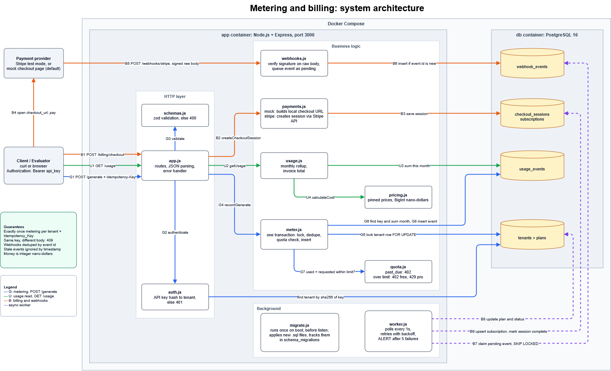

# Usage Metering & Billing Engine

A small backend that meters how much each customer uses an API, stops them when they
hit their plan limit, works out what they owe, and keeps their plan in sync with their
subscription through Stripe webhooks.

Built for the FlyRank Backend Track capstone. Node.js + Express + PostgreSQL + Docker.

## What it does

Customers are called **tenants**. Each tenant is on a plan with monthly limits.

1. **Metering** — every billable request saves one usage event. If the client retries the
   same request, it is still only counted once.
2. **Quotas** — before doing the work, the service checks the tenant's usage against the
   plan limit. If it doesn't fit, the request is rejected with 402 or 429 and a message
   explaining why.
3. **Cost** — API calls and AI tokens are priced with fixed constants. All money is stored
   as integers, so there is no floating point rounding.
4. **Subscriptions** — a checkout flow upgrades a tenant from Free to Pro. Stripe webhooks
   are checked using signatures, de-duplicated, and applied by a background worker.

The AI part is simulated and no model is being called, the request just says how many tokens were used.

## How it is put together



Files:

| File | What it does |
|---|---|
| `src/app.js` | Routes, input validation, error handling |
| `src/auth.js` | Finds the tenant from the API key |
| `src/meter.js` | Saves usage events, handles retries |
| `src/quota.js` | The limit rule and the 402 / 429 decision |
| `src/pricing.js` | Pricing constants and the cost calculation |
| `src/usage.js` | Monthly totals for `GET /usage` |
| `src/payments.js` | Creates checkout sessions (mock or real Stripe) |
| `src/webhooks.js` | Checks the Stripe signature, stores events |
| `src/worker.js` | Background job that applies the events |
| `src/migrate.js` | Runs the SQL files in `migrations/` on startup |
| `src/seed.js` | Demo plans and tenants |

## How to run it

You only need Docker Desktop.

```bash
docker compose up -d --build          
docker compose exec app node src/seed.js   # this creates demo data
curl http://localhost:3000/health          # check the status of db
```

something, copy `.env.example` to `.env`.

Demo API keys created by the seed (only for the local demo, not real secrets):

| Tenant | Plan | API key |
|---|---|---|
| Acme | free | `tk_demo_acme_free` |
| Globex | free | `tk_demo_globex_free` |
| Initech | pro | `tk_demo_initech_pro` |

Running the seed again resets the demo data, so the checks below can be repeated.

## Plans

| Plan | API calls per month | AI tokens per month | Price |
|---|---|---|---|
| Free | 1,000 | 100,000 | $0 |
| Pro | 50,000 | 5,000,000 | $29.00 |

A monthly quotas reset on the 1st at 00:00 UTC.
One `POST /generate` counts as 1 API call plus the tokens it reports.

## The limit rule

> A request is allowed only if **used + requested is less than or equal to the limit**, for
> both quotas. If not, the whole request is rejected and nothing is saved.

So with a 1,000 call limit, the 1,000th call still works and the 1,001st is rejected.

Tokens counted against the quota are `input + output + reasoning`. Cached tokens are
already part of the input tokens, so they are not counted twice.

| Situation | Status code | Why |
|---|---|---|
| Free tenant over the limit | 402 | Upgrading fixes it |
| Pro tenant over the limit | 429 + `Retry-After` | Already on the top plan, so they have to wait |
| Payment failed (`past_due`) | 402 | They need to fix their payment first |

Checks happen in this order: payment status, then API calls, then tokens.

A retry of a request that was already billed still returns the saved response, even if the
quota is now full, because the duplicate check happens before the quota check.

## Pricing

Money is stored as **nano-dollars** (1 dollar = 1,000,000,000). At that size every price is
a whole number, so nothing has to be rounded on each request. Rounding to cents happens
once, at the end.

| Item | Price | Nano-dollars per token |
|---|---|---|
| Input token (not cached) | $0.30 per 1M | 300 |
| Cached input token | $0.03 per 1M | 30 |
| Output token | $2.50 per 1M | 2,500 |
| Reasoning token | same as output | 2,500 |
| API call | $0.001 each | 1,000,000 |

```
cost = (input - cached) * 300 + cached * 30 + (output + reasoning) * 2500 + calls * 1000000
```

`cached_input_tokens` is part of `input_tokens`, which is how the AI APIs report it. So only
the part that was not cached is charged at the full price. Adding the categories together
would charge the cached tokens twice.

Example: input 10,000 (4,000 of them cached), output 2,000, reasoning 1,500, 1 API call:

```
6,000 * 300     = 1,800,000
4,000 * 30      =   120,000
3,500 * 2,500   = 8,750,000
1 * 1,000,000   = 1,000,000
total           = 11,670,000 nano-dollars = $0.011670000
```

`GET /usage` returns this number and also the prices it used.
These prices are made up by me, but they follow the shape of the Gemini pricing
page (cached input is cheaper, thinking tokens cost the same as output).

## API

All endpoints except `/health` and the webhook need `Authorization: Bearer <api key>`.
The tenant is worked out from the key only, never from the URL or the body, so one tenant
can never see another tenant's data.

| Method | Path | Notes |
|---|---|---|
| GET | `/health` | Is the app up and can it reach the database |
| POST | `/generate` | The billable action. Needs an `Idempotency-Key` header |
| GET | `/usage` | Used / limit / remaining and the cost for this month |
| POST | `/billing/checkout` | Starts an upgrade to Pro |
| GET | `/mock-checkout/:id` | The fake checkout page (mock mode only) |
| POST | `/webhooks/stripe` | Stripe webhook |

Example:

```bash
curl -X POST http://localhost:3000/generate \
  -H "Authorization: Bearer tk_demo_acme_free" \
  -H "Idempotency-Key: order-001" \
  -H "Content-Type: application/json" \
  -d '{"input_tokens":10000,"cached_input_tokens":4000,"output_tokens":2000,"reasoning_tokens":1500}'
```

Sending the same request again with the same `Idempotency-Key` returns the same response and
does not create a second usage event. The response header `Idempotent-Replayed` says whether
it was a replay.

## How retries are stopped from double charging

Everything happens in one database transaction:

1. Lock the tenant row, so two requests for the same tenant run one after another.
2. Look up the idempotency key. If it exists with the same request, return the saved
   response. If it exists with a different request, return 409.
3. Check the quota.
4. Work out the cost and save the event together with the response.

There is also a `UNIQUE (tenant_id, idempotency_key)` constraint in the database, so even if
the code had a bug, Postgres would not allow a second event.

## Subscriptions and webhooks

`POST /billing/checkout` gives you a `checkout_url`. Opening it and paying sends a signed
`checkout.session.completed` event to `/webhooks/stripe`, which:

1. checks the signature with Stripe's own SDK function (a fake signature gets 400 and
   nothing is saved),
2. saves the event using the Stripe event id as the primary key, so the same event can never
   be processed twice,
3. leaves the actual work to the background worker.

The worker takes pending events, applies them, retries failures with growing delays
(2s, 4s, 8s...), ignores events older than the last one it applied, and after 5 failed
attempts marks the event as failed and prints an `ALERT` line.

Events handled: `checkout.session.completed` (go to Pro),
`customer.subscription.updated` (sync plan and `past_due`),
`customer.subscription.deleted` (back to Free).

Sending events without a Stripe account:

```bash
# a subscription event built from the subscription currently in the database
node --env-file=.env scripts/send-subscription-event.js past_due --replay
node --env-file=.env scripts/send-subscription-event.js past_due --forge
node --env-file=.env scripts/send-subscription-event.js canceled

# a fixture file
node --env-file=.env scripts/send-webhook.js fixtures/checkout.session.completed.json
```

## Tests

With the app running:

```bash
npm install
npm test
```

They cover retries (including 20 at the same time), the limit at exactly 1,000, tenant
isolation, and the pricing rules with numbers worked out by hand. The output is in
`EVIDENCE.md`.

## Limitations

- **Stripe runs in mock mode by default.** Stripe does not support accounts in Pakistan, so
  I cannot get test keys of my own. What is real: the official Stripe SDK signs and checks
   every event with the same HMAC-SHA256 scheme Stripe uses, so the
s  forged signature and replay checks are genuine. What is faked: Stripe's hosted checkout
  page and Stripe's servers, replaced by a local page and a local signer. Setting
  `PAYMENT_PROVIDER=stripe` with real test keys uses real Stripe instead, which I tested on
  2026-10-04 using a sandbox account . Mock stays the default so this project
  runs without any Stripe account.
- **AI tokens are simulated.** No model is called; the client says how many tokens were used.
- **No overage billing or invoices.** Requests over the limit are rejected, not charged.
- **Usage is added up from the events on every request.** That keeps one source of truth, but
  with a very large number of events a counter table would be faster.
- **The prices are my own numbers**, not any provider's real prices.
- **Quotas reset by calendar month**, not on the date the subscription started.